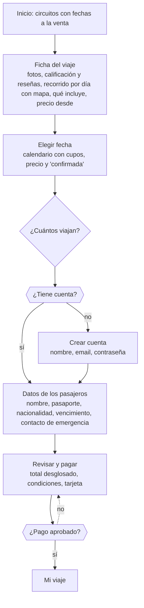
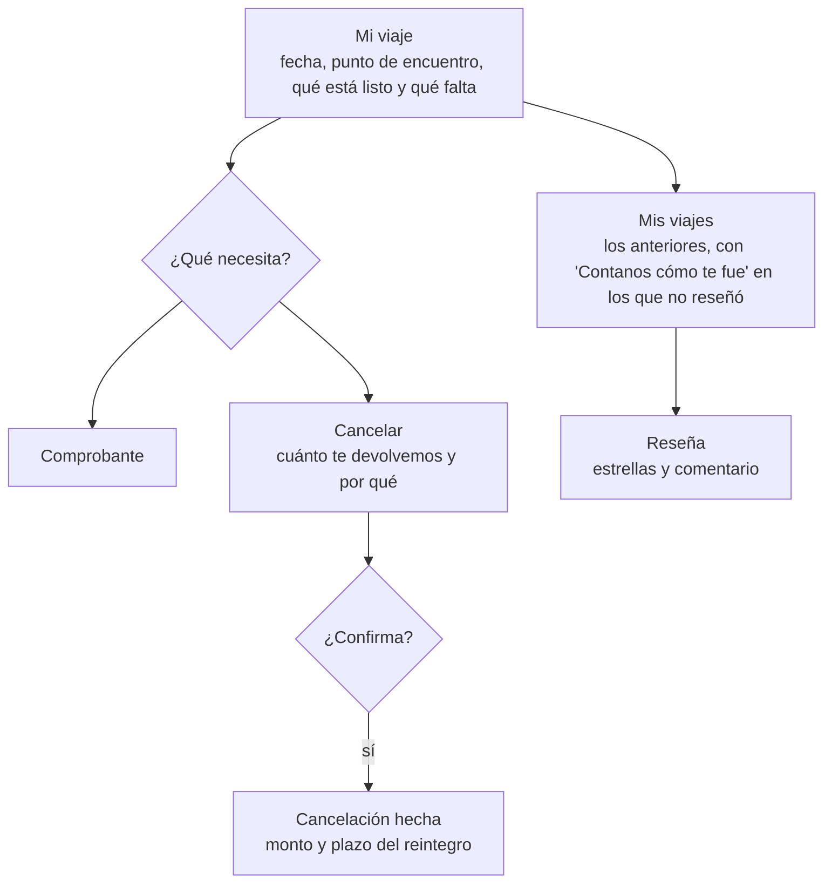
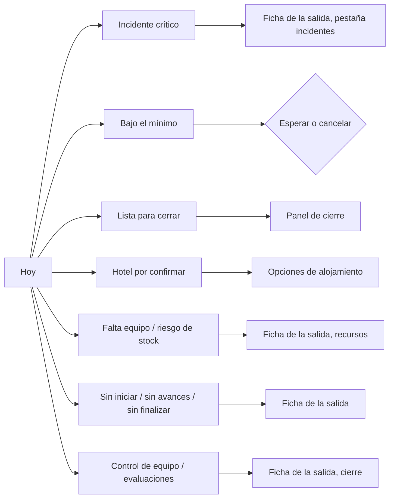
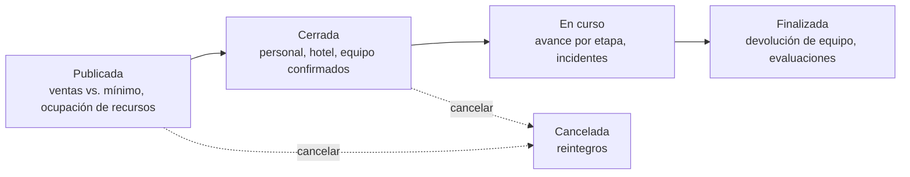
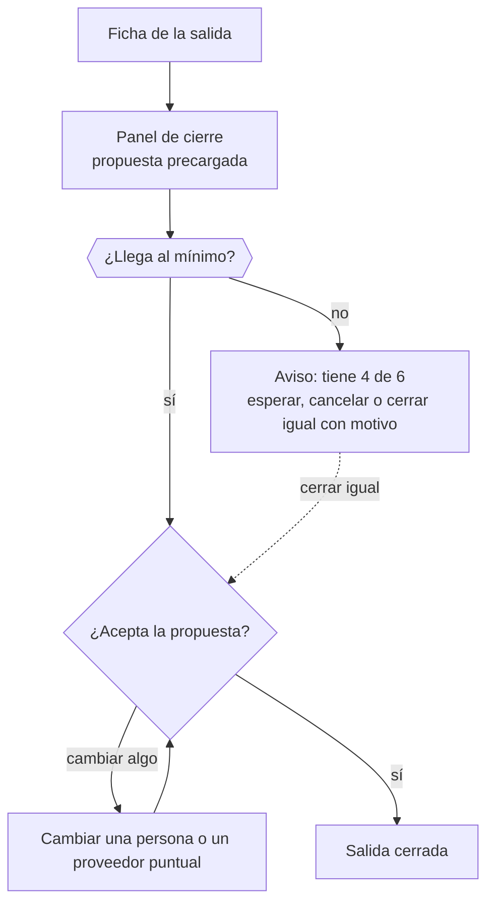
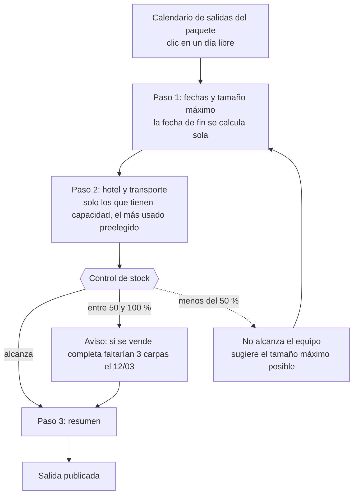
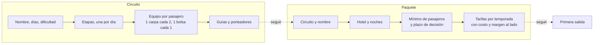
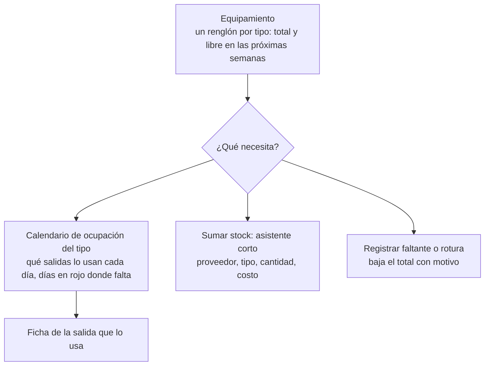
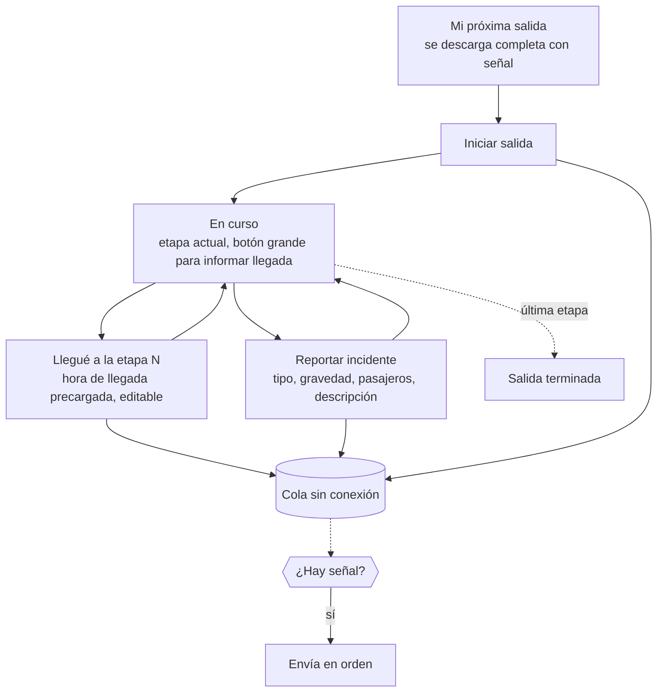

# Tareas y flujos

Etapa 1 del rediseño del front. Define qué hace cada persona, con qué frecuencia y en qué contexto, y el flujo mínimo para cada tarea. Las pantallas salen de acá, no de la lista de casos de uso.

> **Base de evidencia.** No hubo entrevistas con clientes, admins ni guías. Todo lo que sigue sale del plan de rediseño, del back y de cómo funciona el turismo de trekking. Las frecuencias y los dolores son **hipótesis**. Conviene validarlas con al menos una persona por perfil antes de los wireframes. Al final hay una lista de preguntas.

Convenciones de los diagramas:
- Rectángulo: una pantalla o un paso visible.
- Rombo: una decisión de la persona.
- Hexágono: una decisión del sistema (la persona no elige).
- Línea punteada: un camino alternativo o una excepción.

---

## Cliente

**Quién es.** Compra un trekking en Cusco, casi siempre desde el celular y muchas veces desde otro país. Puede comprar para varias personas. Compra una vez y después sigue el viaje durante semanas.

**Qué decide.** La fecha, si el precio le cierra, qué incluye y si la salida va a salir.

### Tareas

| Tarea | Frecuencia | Contexto | Qué necesita ver para decidir |
|---|---|---|---|
| Elegir un viaje | 1 vez, con varias visitas antes | Celular, sin apuro, comparando con otras agencias | Circuito, días, dificultad, precio desde, fotos, calificación de otros viajeros |
| Elegir la fecha | 1 vez | Celular | Fechas con cupo, precio de esa fecha, si la salida está confirmada |
| Comprar | 1 vez | Celular, con el pasaporte a mano | Total, qué incluye, condiciones de reintegro |
| Seguir el viaje | Varias veces hasta la salida | Celular | Si está todo confirmado (hotel, permisos), qué le falta hacer, cuándo y dónde empieza |
| Cancelar | Rara | Celular, con preocupación | Cuánto le devuelven y hasta cuándo |
| Ver sus viajes y opinar | Después de cada viaje | Celular | Qué viajes hizo y cuáles le falta reseñar |

### Momentos de verdad
- **La primera pantalla.** En pocos segundos decide si esta agencia le da confianza o si vuelve a la de al lado. Tiene que impactar.
- **Ver la fecha con "Salida confirmada".** Es lo que separa a una agencia seria de una que cancela a último momento.
- **El total antes de pagar.** Si aparece un costo que no vio antes, se va.
- **La primera vez que abre "Mi viaje" después de pagar.** Tiene que sentir que está todo en orden y saber qué sigue.

### Flujo: elegir y comprar

Decisiones de flujo:
- **El inicio es la vidriera y tiene que impactar.** Es la pantalla donde se gasta la audacia visual del producto: fotografía grande del circuito y poco texto. El resto del flujo de compra es sobrio, para que nada distraiga del pago.
- **Solo aparecen circuitos que se pueden comprar**: con al menos una salida publicada, futura y con cupo. Un circuito sin fechas no se muestra. El front lo filtra con lo que ya trae `GET /catalogo`.
- **La portada destaca como máximo 3 circuitos, y los elige el sistema**: los 3 con la próxima salida confirmada más cercana (si no alcanzan, se completa con la próxima salida a la venta). Nadie los marca a mano. Con 1 solo circuito, la portada queda fija, sin nombres ni flechas. Todos los circuitos a la venta van en "Elegí tu camino"; si son más de 3, debajo de los nombres de la portada aparece "Ver los N circuitos". Así la portada aguanta cualquier cantidad de destinos.
- **Cada paquete muestra su calificación**: el promedio de estrellas y cuántas reseñas lo forman ("4,7 de 5, 38 reseñas"). En la ficha, debajo, algunos comentarios recientes. Con menos de 3 reseñas no se muestra promedio, porque engaña; se dice "Todavía pocas reseñas". La reseña que deja el cliente en "Mis viajes" es la que alimenta esto, así que el circuito se cierra.
- **La cuenta se pide recién al comprar**, no para mirar. Se crea dentro del flujo sin perder lo elegido.
- **El inicio muestra circuitos, no paquetes.** El cliente piensa "quiero hacer el Camino Inca", no "quiero el paquete PAQ-003". Si un circuito tiene varios paquetes, se eligen dentro de la ficha.
- **La fecha va antes que los pasajeros**, porque el precio depende de la temporada y el cupo, de la fecha.
- **El recorrido por día va con mapa.** Cada día muestra el tramo en el mapa, la altura máxima y la distancia. La altura es lo que más pesa para decidir si el viaje es para uno, así que se lee de un vistazo. Si una etapa no tiene coordenadas, ese día se muestra sin mapa, sin romper la ficha.
- **Cada pasajero deja un contacto de emergencia** (nombre y teléfono), obligatorio, en el mismo paso que el pasaporte. Un renglón explica para qué es: "Lo usamos solo si pasa algo durante el viaje".
- **El equipaje no forma parte de la compra.** El cliente no declara peso y el sistema no cobra nada por equipaje: se pesa y se paga en persona en el punto de encuentro. La ficha informa cuánto peso incluye (`pesoEquipajeIncluido`), y el resumen de pago tiene una sola línea: "El equipaje extra se abona en el punto de encuentro". El total que se paga es el total, sin sorpresas.
- **El mínimo de pasajeros no se anuncia al cliente.** Una agencia no promociona la posibilidad de que una salida no salga. Solo se muestra lo positivo: la marca "Salida confirmada" cuando la fecha llega al mínimo. Las fechas sin confirmar se venden mostrando la fecha y los lugares, sin estado. El reintegro total si la agencia cancela queda en las condiciones de compra, no en la vidriera.
- **Lo que no se muestra:** códigos de salida o paquete, el tamaño máximo, la temporada por su nombre interno.

### Flujo: seguir, cancelar y opinar

- **"Mi viaje" muestra el próximo viaje**, y nada más arriba. Si no tiene ninguno, invita a elegir otro circuito.
- **"Mis viajes" es el historial**: un listado de los viajes hechos, con la reseña pendiente bien visible. Es el camino para opinar (ya existe `GET /resenias/historial-reservas`).
- **Estados para el cliente**, en lenguaje propio: "Hotel confirmado" / "Estamos confirmando tu hotel", "Permisos listos" / "Tramitando permisos", "Salida confirmada" (si todavía no lo está, no se muestra ninguna línea).
- **Cancelar muestra el monto antes de confirmar** (ya existe `GET /reservas/:id/cancelacion`).
- **"Mi viaje" anticipa el plazo de cancelación** ("Podés cancelar sin costo hasta el 20/02"). Así el cliente no descubre la regla recién cuando quiere cancelar. Con los permisos emitidos el reintegro pasa a $0, y eso también tiene que estar dicho antes.

---

## Administrador

**Quién es.** Prepara y controla las salidas desde la computadora, todos los días. Conoce el negocio y el vocabulario interno. No necesita que le expliquen, necesita que le ordenen.

**Qué decide.** Qué salidas cerrar, cuáles cancelar, qué recursos faltan y cómo resolver imprevistos.

### Tareas

| Tarea | Frecuencia | Contexto | Qué necesita ver para decidir |
|---|---|---|---|
| Ver qué requiere su decisión | Varias veces por día | Escritorio, primer pantalla del día | Lista ordenada por urgencia, con días hasta la salida |
| Cerrar una salida | Semanal | Escritorio | Vendidos vs. mínimo, propuesta de personal, hotel y equipo |
| Cancelar una salida | Rara | Escritorio | A cuántos clientes afecta y cuánto se devuelve |
| Resolver un hotel pendiente | Semanal | Escritorio | Opciones de alojamiento disponibles |
| Atender un incidente | Rara, urgente | Escritorio o celular | Qué pasó, gravedad, a quién afecta, dónde está la salida |
| Crear una salida | Semanal | Escritorio | Fechas libres, hotel y transporte con capacidad, aviso de stock |
| Armar el catálogo (circuito, paquete, tarifas) | Por temporada | Escritorio | Costo, margen por temporada |
| Administrar equipamiento y stock | Semanal | Escritorio | Cuánto hay de cada tipo, cuánto está comprometido en las próximas semanas, dónde falta |
| Registrar la devolución del equipo | Por salida finalizada | Escritorio | Lo que se entregó, para marcar faltantes |
| Evaluar personal y proveedores | Por salida finalizada | Escritorio | Quiénes participaron |
| Mirar reportes | Mensual | Escritorio | Ventas, ocupación, cancelaciones, calidad |
| Gestionar proveedores, personal y cuentas | Ocasional | Escritorio | Datos de contacto, disponibilidad |

### Momentos de verdad
- **Abrir "Hoy" y que no falte nada.** Si una salida bajo el mínimo no aparece, la agencia pierde plata.
- **Cerrar una salida.** Tiene que revisar, no armar: la propuesta viene precargada.
- **Un incidente crítico.** Tiene que verlo antes que cualquier otra cosa.
- **El uso de todos los días.** Si cargar una salida cansa, el admin la posterga o la carga mal.

### Principios del admin
- **Todo lo necesario, nada de ruido.** Cada ítem de "Hoy" muestra la salida, el problema en una frase, los días que faltan y una acción. El detalle está a un clic, no en la bandeja.
- **Crear es una conversación, no un formulario.** Circuitos, paquetes, salidas y equipamiento se crean con un asistente paso a paso: una pregunta por pantalla, con lo que ya se sabe precargado, una barra de avance y un resumen final antes de confirmar. Se puede volver a cualquier paso sin perder lo cargado.
- **Editar es en el lugar.** El asistente es para crear. Para cambiar un dato suelto, se edita directo en la ficha, sin volver a recorrer los pasos.

### Flujo: "Hoy"

"Hoy" es la pantalla de inicio. Junta todo lo que requiere una acción y nada más. Cada ítem lleva directo al lugar donde se resuelve y desaparece cuando se resuelve.

Orden de la bandeja (de arriba hacia abajo):
1. Incidentes críticos y salidas en curso sin avances. Afectan a personas en la montaña.
2. Lo que vence pronto: bajo el mínimo dentro del plazo de decisión, falta de recurso, hotel pendiente. Se ordenan por días hasta la salida.
3. Lo que se puede hacer hoy pero no apura: propuestas de cierre, riesgo de stock, permisos.
4. Lo administrativo: control de equipo (solo para registrar daños y faltantes; el stock vuelve solo cuando pasa la fecha) y evaluaciones.

Si la bandeja está vacía, lo dice y ofrece la próxima salida por empezar.

Debajo de la bandeja va **Lo que viene**: tres cifras (lo vendido en el mes, los lugares vendidos y las salidas con el mínimo en las próximas 6 semanas) y la lista de esas salidas con su ocupación y estado. No son tareas: sirven para ver venir los problemas (pedido 19).

Un incidente abre su detalle con el contacto de emergencia de cada pasajero afectado a la vista, listo para llamar. Los contactos de todos los pasajeros también están en la ficha de la salida.

### Flujo: ciclo de una salida

Una salida es una ficha con una línea de tiempo. Cada paso muestra qué está resuelto y qué falta. No hay una pantalla distinta por caso de uso.

### Flujo: cerrar una salida

### Flujo: crear una salida (asistente)

### Flujo: catálogo (asistentes)

Tres asistentes encadenados. Al terminar uno, ofrece seguir con el siguiente, sin obligar.

- **El margen se ve mientras se escribe el precio**, no en una pantalla aparte. Si queda por debajo del costo, avisa ahí mismo.
- **Los pasos con valores habituales vienen precargados** (por ejemplo, 1 carpa cada 2 pasajeros). El admin confirma más de lo que escribe.

### Flujo: equipamiento y stock

- **La pregunta que responde la pantalla es "¿me alcanza?"**, no "¿cuántos tengo?". Por eso el dato principal es lo libre en las próximas semanas, con los días críticos marcados.
- **La devolución después de cada salida** se registra desde la ficha de esa salida y solo pide lo que faltó o se rompió. Lo que volvió bien no se toca.

### Navegación del admin
Cinco secciones, en este orden: **Hoy**, **Salidas**, **Catálogo**, **Recursos** (equipamiento y stock, proveedores, hoteles y transporte, con su ocupación), **Personal**. Reportes, clientes, reseñas y cuentas de guía van en un menú secundario. Lo que se usa por temporada no compite con lo diario.

---

## Guía

**Quién es.** Lleva el grupo en la montaña. Usa el celular con una mano, con guantes, al sol o de noche, y pasa días sin señal. No quiere usar el sistema: quiere informar y seguir caminando.

**Qué decide.** Cuándo informar una llegada y si algo es un incidente.

### Tareas

| Tarea | Frecuencia | Contexto | Qué necesita ver para decidir |
|---|---|---|---|
| Ver su próxima salida | Antes de cada salida | Celular, en la ciudad, con señal | Fecha, punto de encuentro, pasajeros, itinerario |
| Iniciar la salida | 1 vez por salida | Celular, en el punto de partida, quizá sin señal | Confirmación simple |
| Informar la llegada a una etapa | 1 por día | Celular, sin señal casi siempre | Etapa actual y la siguiente |
| Reportar un incidente | Rara, urgente | Celular, con estrés, sin señal | Tipo, gravedad, a quién afecta |
| Saber si lo informado llegó | Cada vez que tiene señal | Celular | Qué está enviado y qué está en espera |

### Momentos de verdad
- **Reportar un incidente sin señal.** Tiene que quedar guardado y salir solo cuando vuelva la señal, sin que lo vuelva a escribir.
- **Llegar a la última etapa.** El sistema finaliza la salida. El guía tiene que ver que terminó.

### Principio del guía
**Simple antes que lindo.** El objetivo es que use la app el menor tiempo posible y sin pensar. No hay vidriera ni adorno: texto grande, alto contraste para leer al sol, una acción por pantalla y nada que haya que aprender. Si una pantalla necesita explicación, sobra algo.

### Flujo

Decisiones de flujo:
- **Todo se guarda primero en el celular.** El back ya separa la hora del hecho de la hora del reporte, así que se puede enviar después sin perder información.
- **Informar una llegada es un toque**, con la hora actual precargada. Si el grupo llegó tarde, un segundo toque la marca como demorada (el back ya acepta `DEMORADO`).
- **El teléfono de emergencia de la agencia está siempre a un toque**, en la salida en curso y en la pantalla de incidente. El guía no ve los contactos de los pasajeros: ante un problema llama a la agencia o reporta el incidente.
- **Siempre se ve el estado de la cola:** "2 cosas por enviar" o "Todo enviado".
- **La salida y los pasajeros se descargan antes de salir**, con señal. Sin eso, no se puede iniciar sin conexión.
- **Una acción principal por pantalla**, con objetivos grandes (más de 44 px; apuntamos a 56 px para usar con guantes).

---

## Pedidos al back

Datos o comportamientos que el diseño necesita y que el back todavía no tiene. Los que dependen del plan (A1 a A4) ya están previstos y se marcan así.

| # | Pedido | Para qué | Estado |
|---|---|---|---|
| 1 | En el catálogo, por salida: `confirmada` (vendidos ≥ mínimo) y cuántos faltan | "Salida confirmada" y "faltan 2 personas" | **Sí, con A3.** Hoy no existe `minimoPasajeros` |
| 2 | Descripción corta del paquete y lista de "qué incluye" escrita para el cliente | La ficha del viaje. Hoy `serviciosAdicionales` son nombres internos de servicios (por ejemplo, el nombre del hotel) | **Sí.** `descripcionCorta` e `incluye` en Paquete, congelados en la salida |
| 3 | Punto y hora de encuentro de la salida | "Mi viaje" y la ficha del guía | **Sí.** `puntoEncuentro` y `horaEncuentro` por defecto en el paquete, editables por salida |
| 4 | Recorrido por día: `dia`, `altitudMaxima` y `distanciaKm` por etapa, más latitud y longitud del inicio y del fin | La ficha del viaje, con el mapa de cada día | **Decidido: sí.** Se diseña con mapa |
| 5 | Estado de permisos de la reserva en `GET /reservas/:id`, y la fecha límite para cancelar con reintegro del 100 % | "Permisos listos / tramitando" y "Podés cancelar sin costo hasta el 20/02" en "Mi viaje" | **Sí, cambio chico.** La fecha sale de `fechaInicio − diasMinimosReintegro`; falta exponer `permisosEmitidos` y `fechaLimiteReintegro` |
| 6 | Un `GET /hoy` (o equivalente) que junte alertas de salidas, solicitudes, incidentes, devoluciones y evaluaciones con días hasta la salida y prioridad | La bandeja "Hoy" sin 5 pedidos en paralelo | **Sí.** `GET /admin/hoy`, con prioridad y días restantes. La devolución pasa a "control de equipo pendiente", de prioridad baja (ver A1) |
| 7 | Alertas `BAJO_MINIMO`, `RIESGO_STOCK`, `FALTA_RECURSO` en `resumirSalida` | "Hoy" | **Sí, con A2b y A3** |
| 8 | Avances e incidentes idempotentes (un id generado en el celular) | Reenviar desde la cola offline sin duplicar ni recibir 400 por "etapa ya completada" | **Sí, cambio chico.** Un `idLocal` único en Avance e Incidente: reenviar devuelve el registro existente. Hoy un COMPLETADO reenviado da 400 y un incidente se duplica |
| 9 | Teléfonos de emergencia: el de la agencia (configuración) y un contacto por pasajero (nombre y teléfono) | Ficha del guía (agencia) y detalle de incidente y de salida del admin (pasajeros) | **Decidido: sí** (A4b). Contacto del pasajero obligatorio en la compra; el guía no lo ve; va en el mail de incidente crítico |
| 10 | Sacar el equipaje de la compra: `POST /reservas` deja de recibir `pesoDeclarado` y de cobrar `adicionalesEquipaje` | Que el total de la compra no dependa de un dato que el cliente no sabe | **Decidido: sí.** Se pesa y se cobra en persona en el punto de encuentro, por fuera del sistema |
| 11 | Peso máximo de equipaje extra por pasajero | Informar cuánto más se puede llevar | **Decidido: no por ahora.** La franquicia se informa con `pesoEquipajeIncluido`. El equipaje extra prepago queda para más adelante |
| 12 | Calificación por paquete en `GET /catalogo`: promedio y cantidad de reseñas, más un endpoint público con las últimas reseñas del paquete (nombre de pila, estrellas, comentario, fecha). Hoy `Resenia` está ligada a la salida y `GET /resenias` es solo para el admin | Mostrar la calificación en el inicio y las reseñas en la ficha del viaje | **Sí.** Promedio y cantidad agregados en `GET /catalogo` y `GET /paquetes/:id/resenias` público, con nombre de pila |
| 13 | Teléfono del personal (`Personal.telefono`) | "Llamar al guía" en Hoy y en la ficha de la salida | **Sí, lo anotó el back** |
| 14 | Costos y márgenes (A4): `GET /paquetes/:id/costos`, `POST /paquetes/costos/simular` y `GET /salidas/:id/costos`, con el desglose por pasajero y el margen por temporada | El margen en vivo al poner precios y el costo real de cada salida | **Sí, por etapas.** Primero hotel, transporte y tren; el equipo con A2; guías, porteadores y permisos cuando existan `Personal.costoDiario` y `Circuito.costoPermisoPorPersona`. Moneda: USD |
| 15 | Recuperación de contraseña | Ingreso de clientes, admin y guías | **Para más adelante.** El ingreso deja el lugar del enlace, oculto |
| 16 | Finalizar una salida a mano, con motivo obligatorio | Cuando el grupo no puede terminar (por ejemplo, una evacuación). Lo pueden hacer el guía (desde "En curso", también sin señal) y el admin (desde la ficha) | **Sí (A4c).** Pasa a FINALIZADA, queda en auditoría y avisa al admin por mail |
| 17 | Presentismo: `ausentes[]` al iniciar la salida | El guía destilda a quien no llegó; se corrige hasta el primer avance. El admin lo ve en Pasajeros y en Hoy | **Sí (A4c).** Es un no-show: sin reintegro ni liberación de lugares, y no se muestra |
| 18 | Teléfono de la agencia en el detalle de la salida del guía | "Llamar a la agencia" sin señal | **Sí, con A4b** |
| 19 | Sumar a `GET /admin/hoy` un resumen de lo que viene: lo vendido en el mes, y por cada salida de las próximas 6 semanas la fecha, el circuito, vendidos, cupo, mínimo, estado y fecha límite de decisión | El bloque "Lo que viene" de Hoy: anticipar salidas bajo el mínimo antes de que sean tareas | **Por pedir** |

---

## Pantallas del admin pendientes de diseño

Surgieron al contrastar los wireframes con los endpoints del back. Ninguna cambia lo ya diseñado.

- **Edición.** Los asistentes son para crear. Circuito, paquete, temporada, proveedor, servicio, personal y cuenta de guía se editan en su ficha, y tienen baja. La edición de un paquete avisa que no cambia las salidas ya creadas, salvo las tarifas.
- **Bajas.** Paquete, circuito y temporada se dan de baja (el back lo rechaza si hay salidas activas). Una salida no se despublica: se cancela.
- **Reembolsos.** Una lista con la reserva, el monto, la regla aplicada y la fecha. Son automáticos: no hay reintegros manuales.
- **Recursos, Personal, temporadas, reportes, clientes, reseñas, cuentas de guía, solicitudes de alojamiento, reemplazos, devolución de equipo y evaluaciones.**
### Pantallas del cliente pendientes de diseño

- **Filtros del catálogo.** Una barra sobre la lista de circuitos con dificultad, duración y fechas (`GET /catalogo` ya los acepta). Con pocos circuitos puede esperar.
- **Recuperar contraseña** (pedido 15), para más adelante.
- Ya diseñadas en esta vuelta: Mi cuenta (`mi-cuenta.html`), el recorrido sin señal en Mi viaje y en el guía, presentismo y finalizar a mano (guía y ficha de la salida).
- Lo que ya resuelve el back y no necesita pantalla nueva: el alta y el ingreso dentro de la compra (no hay compra como invitado), las reseñas, el comprobante y "lugares ocupados mientras completaba" (409). Los lugares no se retienen mientras el cliente completa sus datos.

- **Fuera de alcance, por decisión del back:** cambiar las fechas de una salida (se cancela y se crea otra) y mover pasajeros entre salidas (se cancela y se vuelve a comprar).

## Preguntas para validar

1. **Cliente:** ¿compran más desde el celular o desde la compu? ¿Cuántos compran para un grupo? ¿Qué les hace dudar antes de pagar?
2. **Admin:** ¿qué mira primero a la mañana hoy? ¿Cuántas salidas maneja a la vez? ¿Usa el sistema desde el celular cuando hay un incidente?
3. **Guía:** ¿qué celular usa? ¿Cada cuánto tiene señal en cada circuito? ¿Informa en el momento o al llegar al campamento?
4. **Todos:** ¿en qué idioma? El cliente probablemente necesite inglés. Si es así, hay que decidirlo antes de la identidad, porque cambia la tipografía y el largo de los textos.

---

## Pantallas clave que salen de acá

Estas son las que propongo llevar a wireframe en la etapa 3:

- **Cliente: inicio.** La vidriera, donde se juega la primera impresión.
- **Cliente: ficha del viaje con el calendario de fechas.** Es la decisión de compra.
- **Cliente: revisar y pagar.**
- **Cliente: Mi viaje y Mis viajes.**
- **Admin: Hoy.**
- **Admin: ficha de la salida con la línea de tiempo y el panel de cierre.**
- **Admin: asistente de creación**, con la salida como ejemplo. Define el patrón que después usan circuito, paquete y equipamiento.
- **Guía: salida en curso con la cola offline.**
