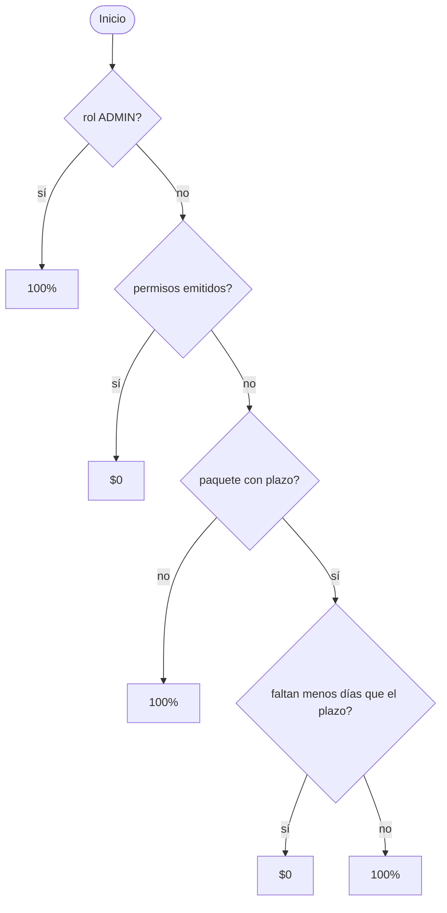

# Prueba de caja blanca: cancelación de reserva (CU-32)

**Por qué este código:** es el flujo con más decisiones encadenadas del sistema. El reintegro depende del rol, los permisos y el plazo, y la cancelación mueve stock, plazas de hotel, permisos y solicitudes dentro de una transacción.

**Cómo se ejecuta**, desde `backend`:

```bash
npm run test:caja-blanca
```

Los casos están en `backend/src/modulos/reservas/gestion-reservas/cancelacion.caja-blanca.test.ts`. No necesitan base de datos: la transacción se simula.

## Técnica

Prueba de caminos básicos (McCabe). La complejidad ciclomática se calcula como `V(G) = condiciones simples + 1`, y se diseña al menos un caso por camino independiente. Además se prueban los límites de cada comparación.

| Función | Archivo | Condiciones | V(G) |
|---|---|---|---|
| `calcularReintegro` | `reintegro.ts` | 4 | **5** |
| `verificarAcceso` | `gestion-reserva.service.ts` | 3 | **4** |
| `evaluarCancelacion` | `gestion-reserva.service.ts` | 6 | **7** |
| `confirmarCancelacion` | `gestion-reserva.service.ts` | 3 | **4** |
| `cancelarReserva` | `gestion-reserva.repository.ts` | 13 | **14** |

## Grafo de `calcularReintegro`



| Caso | Camino | Entrada | Resultado esperado |
|---|---|---|---|
| R1 | B sí | Administrador con permisos emitidos | 100% |
| R2 | B no, C sí | Cliente con permisos emitidos | $0 |
| R3 | B no, C no, D no | Paquete sin plazo, salida mañana | 100% |
| R4 | D sí, E sí | Faltan 14 días, plazo 15 (límite) | $0 |
| R5 | D sí, E no | Faltan 15 días, plazo 15 (límite) | 100% |

## Caminos de `evaluarCancelacion` y `verificarAcceso`

| Caso | Condición recorrida | Resultado esperado |
|---|---|---|
| E1 | Reserva inexistente | 404 |
| E2 | Cliente que no es titular | 403 |
| E3 | Rol que no es cliente ni administrador | 403 |
| E4 | Reserva que no está Confirmada | 400 |
| E5 | La salida empieza hoy (límite) | 400 |
| E6 | Salida futura en EN_CURSO, FINALIZADA o CANCELADA | 400 |
| E7 | A la venta y sin permisos | Los lugares vuelven a la venta |
| E8 | Permiso emitido | No vuelven, hay advertencia y $0 |
| E9 | Permiso en otro estado | No cuenta como emitido |
| E10 | Salida CERRADA sin permisos | No vuelven a la venta |

## Caminos de `confirmarCancelacion`

| Caso | Camino | Resultado esperado |
|---|---|---|
| C1 | Sin cambios en el medio | Cancela y avisa al titular |
| C2 | Cambió una vez | Recalcula y cancela |
| C3 | Cambió dos veces | 409 |
| C4 | Otro pedido canceló antes | 409 y sin aviso |
| C5 | Falla el mail | La cancelación queda firme |
| C6 | Cancela el administrador | Reintegro 100% |
| C7 | Solicitud de hotel confirmada | El alojamiento no se trata como stock |

## Caminos de `cancelarReserva`

| Caso | Situación | Resultado esperado |
|---|---|---|
| P1 | Aparecieron permisos desde el cálculo | `CAMBIO`, no toca nada |
| P2 | La salida dejó de estar a la venta | `CAMBIO` |
| P3 | La reserva ya no está Confirmada | `null`, sin reembolso |
| P4 | A la venta, alojamiento por solicitud | Repone lugares, no plazas |
| P5 | A la venta, alojamiento por stock | Repone lugares y plazas |
| P6 | Permisos emitidos, alojamiento por stock | Permisos en Perdido, repone solo plazas |
| P7 | Permisos emitidos, alojamiento por solicitud | No repone nada |
| P8 | Salida cerrada, alojamiento por stock | Las plazas vuelven al hotel |
| P9 | Salida cerrada sin hotel asignado | No falla |

`cancelarReserva` tiene V(G) 14 y se recorre con 9 casos porque V(G) es una cota máxima: varias condiciones dependen de las mismas variables (`reponerLugares` y `reponerPlazas`, por ejemplo), así que no todas las combinaciones son posibles. Lo que se exige es cubrir todas las ramas.

## Resultado

**33 de 33 casos correctos.** Cobertura de la lógica de cancelación: 74 de 74 sentencias y 62 de 62 ramas (100%).

| Función | Sentencias | Ramas |
|---|---|---|
| `calcularReintegro` | 14/14 | 8/8 |
| `solicitarCancelacion` y `confirmarCancelacion` | 14/14 | 8/8 |
| `cancelar` y `evaluarCancelacion` | 20/20 | 14/14 |
| `verificarAcceso` | 5/5 | 6/6 |
| `cancelarReserva` | 21/21 | 26/26 |

El comando informa porcentajes más bajos por archivo porque esos archivos también tienen la consulta de reservas (CU-31), que no es parte de esta prueba.

## Qué aportó

La medición detectó un hueco: ningún test pasaba una reserva con solicitud confirmada, así que esa condición de `alojamientoPorStock` nunca se evaluaba. Se agregó el caso C7. La lógica no tenía errores.

`findParaCancelacion` queda sin cubrir aquí porque solo es una consulta a la base. Se ejercita en `npm run test:integral`.
